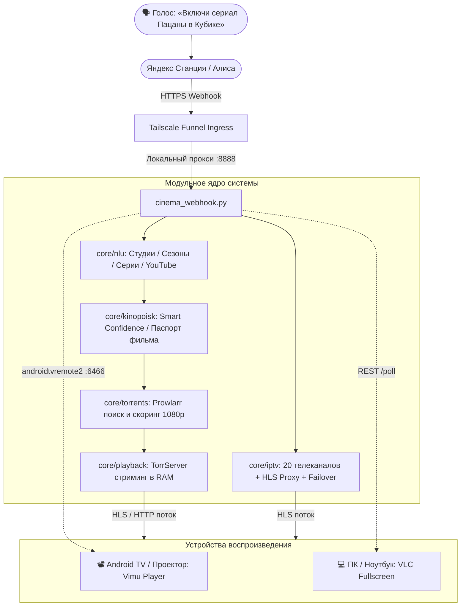

# 🍿 Alice Cinema Bridge

[](https://www.python.org/)
[](https://www.docker.com/)
[](https://github.com/YouROK/TorrServer)
[](https://prowlarr.com/)
[](https://tailscale.com/)
[](LICENSE)

Умный голосовой мост между ассистентом **«Алиса»** (Яндекс Диалоги / Станция / смартфон) и домашними экранами (**Android TV / Проектор** и **ПК / Ноутбук**). Обеспечивает мгновенный запуск фильмов, сериалов, торрентов, IPTV и YouTube без предварительного скачивания файлов на диск.

---

## 📐 Архитектура системы



---

## ⚡ Быстрый старт за 5 минут

### 1. Клонирование репозитория
```bash
git clone https://github.com/qsxftt/alice-cinema-bridge.git
cd alice-cinema-bridge
```

### 2. Установка зависимостей Python
```bash
pip install -r requirements.txt
```

### 3. Настройка переменных окружения
Скопируйте шаблон `.env.example` в `.env` и укажите свои параметры:
```bash
cp .env.example .env
```
Основные параметры в `.env`:
* `KINOPOISK_API_KEY` — бесплатный ключ с [poiskkino.dev](https://poiskkino.dev/).
* `SECRET_TOKEN` — любой ваш секретный пароль для защиты вебхука (например, `my_super_secret_123`).
* `PROJECTOR_IP` — IP-адрес проектора или Android TV в локальной сети.

### 4. Запуск TorrServer и Prowlarr в Docker
```bash
docker compose up -d
```
* **TorrServer:** доступен по адресу `http://<IP_СЕРВЕРА>:8090`.
* **Prowlarr:** доступен по адресу `http://<IP_СЕРВЕРА>:9696`. В настройках Prowlarr добавьте любимые трекеры (RuTracker, RuTor, NNMClub) и скопируйте API Key в `.env`.

### 5. Первичное спаривание с Android TV / Проектором
Включите проектор и запустите скрипт спаривания:
```bash
python pair_projector.py
```
На экране проектора появится 6-значный PIN-код. Введите его в консоли — скрипт сохранит постоянные SSL-сертификаты для бесшовного управления.

### 6. Запуск сервера вебхука
```bash
python cinema_webhook.py
```

---

## 🎙️ Примеры голосовых команд Алисе

| Категория | Что сказать Алисе |
| :--- | :--- |
| **Фильмы** | *«Включи Интерстеллар»*<br>*«Поставь фильм 1+1 2011 года»*<br>*«Запусти Дюна часть вторая»* |
| **Озвучки** | *«Включи Во все тяжкие в озвучке Кубик в кубе»*<br>*«Поставь Рик и Морти от Сыендука»*<br>*«Запусти Криминальное чтиво в переводе Гоблина»* |
| **Сериалы** | *«Включи сериал Декстер 7 сезон 5 серия»*<br>*«Поставь Игра престолов третий сезон»*<br>*«Запусти Пацаны 4 сезон 1 серия в Кубике»* |
| **ТВ-каналы** | *«Включи СТС»*<br>*«Поставь телеканал Матч ТВ»*<br>*«Запусти прямой эфир Россия 24»* |
| **YouTube** | *«Включи Ютуб»*<br>*«Найди на ютубе космические запуски SpaceX»* |
| **Управление** | *«Выход»* / *«Стоп»* / *«Отмена»* (работает на любом шаге диалога) |

---

## 🚀 Ключевые возможности

### 🎬 Стриминг на лету без ожидания
* **Буферизация в память:** видео начинает воспроизводиться через 3–5 секунд после команды, жесткий диск сервера не изнашивается.
* **Ответ Алисе за 0.2 секунды:** сервис мгновенно подтверждает команду («Включаю фильм...»), а поиск по трекерам и буферизация выполняются асинхронно в фоне.
* **Автоматическая очистка:** завершенные раздачи удаляются из TorrServer автоматически, при этом активные стримы надежно защищены от сброса.

### 🧠 Умный NLU парсер
* **20+ студий озвучек:** Кубик в кубе, LostFilm, Сыендук, NovaFilm, Red Head Sound, HDRezka, NewStudio, Кураж-Бамбей, AlexFilm, TVShows, Flarrow Films, Студийная Банда, AniLibria, AniDUB, SHIZA Project, Jaskier, Гоблин, Сербин, Гаврилов, Володарский, Дубляж.
* **Порядковые числительные:** понимает фразы вроде *«четвертый сезон пятая серия»*.
* **Безопасность предлогов:** никогда не отрезает предлоги из названий фильмов (*«В диких условиях»*, *«Властелин колец»*).
* **Многосезонные паки:** умеет находить нужную серию внутри огромных раздач (1–8 сезоны).

### 📺 20 Федеральных каналов РФ (IPTV)
* **1-й и 2-й мультиплексы:** Первый канал, Россия 1, Матч ТВ, НТВ, Пятый канал, Культура, Россия 24, Карусель, ОТР, ТВЦ, РЕН ТВ, Спас, СТС, Домашний, ТВ-3, Пятница!, Звезда, МИР, ТНТ, Муз-ТВ.
* **Авто-Failover:** при недоступности основного стрима сервер за 1 секунду переключается на рабочий резерв.
* **Встроенный HLS-прокси:** обход ограничений по Referer для РЕН ТВ и Карусели.
* **GitHub Sync:** фоновая проверка и пополнение резервных потоков из проверенных репозиториев.

### 🖥️ Два целевых экрана: Проектор и ПК
* **Проектор / Android TV:** прямой запуск в плеере Vimu через протокол `androidtvremote2` (порт 6466).
* **ПК / Ноутбук:** клиент `laptop_receiver.py` опрашивает сервер и разворачивает поток в полноэкранном VLC.
* Переключение в 1 команду: `python switch_target.py pc` или `python switch_target.py projector`.

---

## 🌐 Публикация вебхука (Tailscale Funnel)

Яндекс Диалогам требуется публичный HTTPS-адрес. Самый простой и безопасный способ без «белого» IP и открытия портов роутера — **Tailscale Funnel**:

1. Установите [Tailscale](https://tailscale.com/) на сервер.
2. Включите Funnel:
   ```bash
   tailscale funnel --bg --yes 8888
   ```
3. Вы получите URL вида: `https://your-node.tailnet.ts.net`
4. В панели [Яндекс Диалогов](https://dialogs.yandex.ru/developer):
   * Создайте приватный навык.
   * Укажите Webhook URL: `https://your-node.tailnet.ts.net/?secret=ВАШ_СЕКРЕТНЫЙ_ТОКЕН`
   * Активируйте приватный доступ для своего аккаунта.

---

## 🛡️ Самовосстанавливающийся сторож (Watchdog)

При смене внешнего IP или перезапуске роутера туннель может сбиться. В проект включен сторож [tailscale_watchdog.sh](tailscale_watchdog.sh) и готовые systemd-юниты:

```bash
sudo cp tailscale-watchdog.service tailscale-watchdog.timer /etc/systemd/system/
sudo systemctl daemon-reload
sudo systemctl enable --now tailscale-watchdog.timer
```
Сторож каждые 60 секунд проверяет локальный сервис, внешний URL и жестко следит за флагом `--accept-dns=false`, предотвращая конфликты с локальными DNS (AdGuard Home / Pi-hole).

---

## 📁 Структура проекта

```
alice-cinema-bridge/
├── cinema_webhook.py          # Главная точка входа вебхука (HTTP-сервер)
├── core/                      # Ядро системы:
│   ├── config.py              # Конфигурация (.env) и глобальное состояние
│   ├── nlu.py                 # NLU парсер естественной речи
│   ├── iptv.py                # База ТВ-каналов, HLS прокси и failover
│   ├── kinopoisk.py           # Поиск и Smart Confidence по Кинопоиску
│   ├── torrents.py            # Поиск в Prowlarr и скоринг раздач
│   └── playback.py            # Индексация TorrServer и запуск плеера
├── pair_projector.py          # Скрипт спаривания с Android TV / Проектором
├── switch_target.py           # Переключатель вывода (Проектор <-> ПК)
├── laptop_receiver.py         # Фоновый плеер для ПК (VLC)
├── tailscale_watchdog.sh      # Сторожевой скрипт самовосстановления
├── tailscale-watchdog.service # systemd юнит сторожа
├── tailscale-watchdog.timer   # systemd таймер сторожа (каждые 60 сек)
├── cinema-bridge.service      # systemd юнит вебхука
├── docker-compose.yml         # Стек TorrServer + Prowlarr
├── requirements.txt           # Зависимости Python
└── .env.example               # Шаблон настроек
```

---

## 📄 Лицензия

Проект распространяется под лицензией [MIT](LICENSE).
